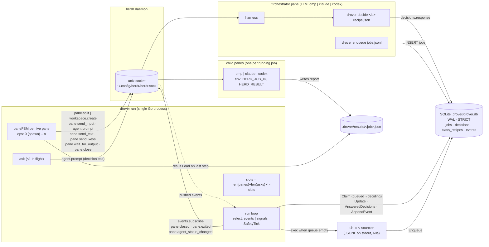
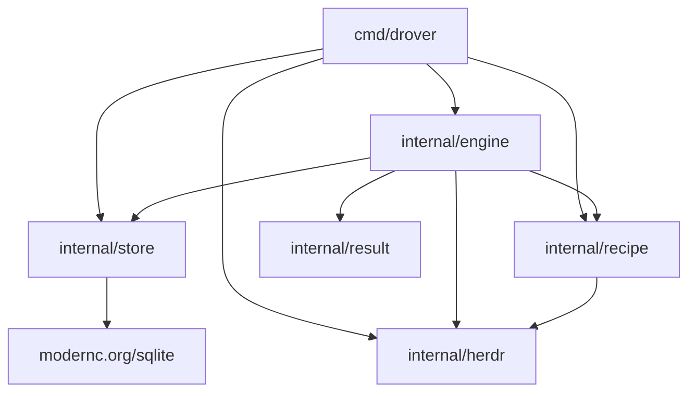
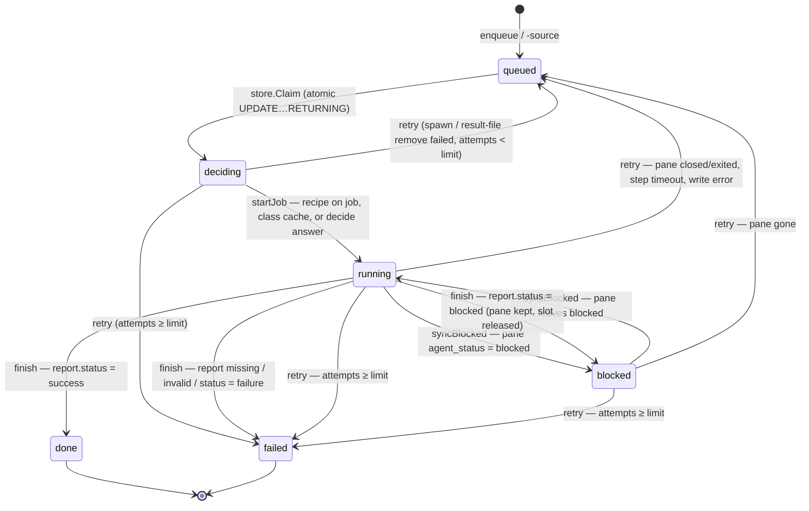
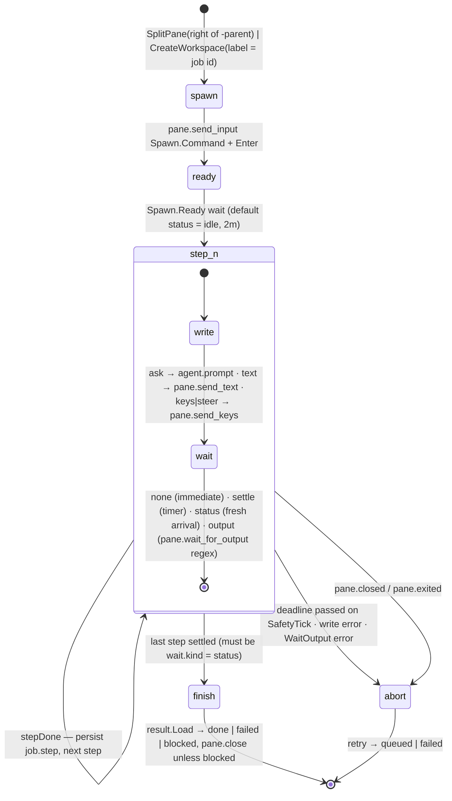
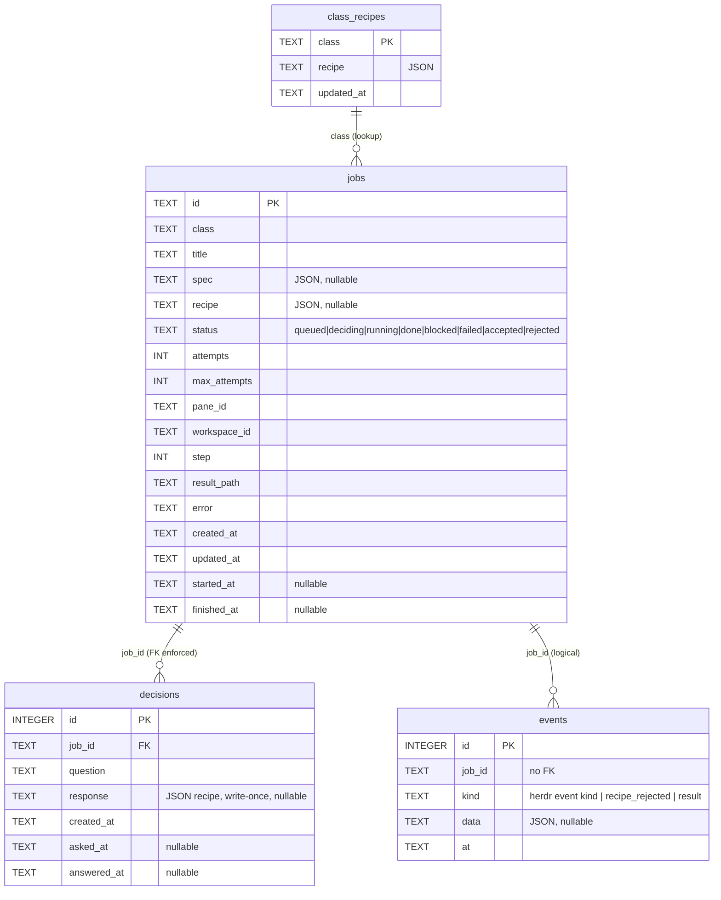

# drover architecture

Derived from code, not from README prose. Every box and edge traces to a
file/symbol named in the notes under each diagram.

## 1. Runtime topology



Sources: `cmd/drover/main.go` (`cmdRun`, `cmdDecide`, `cmdEnqueue`),
`internal/engine/engine.go` (`Run`, `subscribe`, `fill`, `busy`),
`internal/engine/fsm.go` (`compile`, `startJob`, `send`, `finish`),
`internal/engine/decide.go` (`deliverPendingAsk`), `internal/engine/source.go`
(`pullSource`), `internal/herdr/ops.go` (RPC method table),
`internal/herdr/client.go` (`resolveSocket`, `exchange`, `Subscribe`).

Notes:
- `drover decide` never talks to the engine or the socket. It validates the
  recipe (`recipe.Parse`) and writes `decisions.response`; the engine reads it
  on the next orchestrator status event or SafetyTick (`checkDecisions`).
- `drover enqueue`, `status`, `jobs`, `events` are pure SQLite clients.
  `doctor` is socket-only (`ping`, `pane.current`).
- Each RPC call dials its own unix connection (NDJSON request/response);
  `events.subscribe` keeps its connection open and streams `{event,data}`
  envelopes into a 256-slot channel (overflow drops, counted).
- The bash scripts in `../scripts/` wrap the `herdr` CLI against the same
  daemon; they never touch `drover.db`.

## 2. Package dependency graph



`recipe` imports `herdr` only for `AgentStatus`. `store` and `herdr` are leaf
packages with no dependency on each other. `result` imports nothing internal.

## 3. Job state machine (`store.JobStatus`)



Sources: `store/sqlite.go` (`Claim`), `engine/engine.go` (`transition`,
`retry`, `attemptLimit`), `engine/fsm.go` (`startJob`, `syncBlocked`,
`finish`, `checkDeadlines`, `onPaneEvent`), `engine/reconcile.go`.

- `attemptLimit` = min(`-max-attempts` if > 0, `job.max_attempts`); default
  per-job 2.
- `accepted` / `rejected` exist in the enum (`store/types.go`) but no code path
  writes them.
- Report-driven `blocked` drops the FSM and sets `finished_at`; reconcile will
  not resume it and nothing in the engine moves it onward.

## 4. Per-pane step FSM (`engine.paneFSM`)



Sources: `engine/fsm.go` (`compile`, `arm`, `await`, `send`, `waitOutput`,
`onPaneEvent`, `onSignal`, `stepDone`, `finish`, `abort`, `drop`), `recipe/types.go`.

- The recipe is normalised once (`compile`) into `ops`: op 0 runs the spawn
  command and waits for `spawn.ready` (default idle); op i is recipe step i.
  `job.Step` indexes ops.
- Each `arm` (`stamp` + write + `await`) increments `gen`; signals tagged with
  a stale `gen` are ignored.
- `status` waits require a *fresh* arrival: events received before the write
  (`ReceivedAt < armedAt`) are ignored; the pane must leave the target status
  then return to it, unless resuming an orphan pane whose result file already
  exists.
- An `ask` (not a slash command) must show it started a turn: herdr can report
  an agent idle before its input accepts Enter, leaving the prompt typed but
  unsent. If no fresh `working` or `blocked` status arrives within
  `-submit-check` (20s), Enter is resent (`pane.send_keys`); after 3 resends
  with no turn the attempt fails with `step N: prompt not submitted`.
- Timeouts: per-wait `timeout`, else `-ready-timeout` (2m) for op 0 and
  `-step-timeout` (30m) for ops ≥ 1, resolved once in `compile`. Checked on
  each `-tick` (30s), so granularity is the tick.

## 5. One job, end to end

```mermaid
sequenceDiagram
    participant O as Orchestrator pane
    participant E as drover run
    participant DB as SQLite
    participant H as herdr
    participant C as child pane
    participant FS as $HERD_RESULT

    O->>DB: drover enqueue (INSERT jobs, status=queued)
    E->>DB: Claim → deciding
    alt recipe on job or class_recipes hit
        E->>E: recipe.Parse
    else miss / invalid
        E->>DB: CreateDecision(job, question)
        E->>H: agent.prompt(orchestrator, "drover decision N … Reply: drover decide N '<recipe>'")
        H->>O: prompt delivered
        O->>DB: drover decide N recipe.json (AnswerDecision)
        H-->>E: pane.agent_status_changed(orchestrator → idle)
        E->>DB: AnsweredDecisions → recipe.Parse → SaveClassRecipe
    end
    E->>H: pane.split | workspace.create (env HERD_JOB_ID, HERD_RESULT)
    E->>DB: Update → running, step=0
    E->>H: events.subscribe pane.agent_status_changed(pane)
    E->>H: pane.send_input Spawn.Command
    H-->>E: agent_status idle (ready)
    loop each recipe step
        E->>H: agent.prompt | pane.send_text | pane.send_keys
        H->>C: input
        H-->>E: agent_status event | wait_for_output match | settle timer
        E->>DB: Update job.step
    end
    C->>FS: write report {job_id, status, summary, …}
    H-->>E: agent_status done (last step)
    E->>FS: result.Load (strict; job_id must match)
    E->>DB: AppendEvent(result), Update → done | failed | blocked
    E->>H: pane.close (unless blocked)
```

Sources: `engine/fill`, `engine/dispatch`, `decide.go`, `fsm.go`,
`cmd/drover/main.go` (`cmdDecide`), `result/result.go`.

## 6. Data model



Source: `store/schema.sql`, `store/types.go`, `store/sqlite.go`
(`journal_mode(WAL)`, `busy_timeout(5000)`, `foreign_keys(1)`). Indexes:
`jobs_status(status, created_at)`, partial `decisions_pending(id) WHERE
response IS NULL`, `events_job(job_id)`. Times are fixed-width UTC TEXT so
sort order is chronological.

## 7. Trace: one pane start-up and one job, end to end

### Preconditions

1. herdr daemon up; socket resolved `$HERDR_SOCKET` → `$HERDR_SOCKET_PATH` →
   `~/.config/herdr/herdr.sock` (`herdr/client.go` `resolveSocket`). `Dial` pings once.
2. `herdr integration install <kind>` for the harness the recipe spawns.
   Without it `agent_status` never changes and every `status` wait times out.
   drover does not check this.
3. `drover run -orchestrator <pane>` (`cmd/drover/main.go` `cmdRun`).
   `-parent` defaults to the orchestrator; `-results` is made absolute.
4. A `queued` row in `jobs` (`drover enqueue` or `-source`).
5. A recipe: on the job, in `class_recipes`, or an idle orchestrator to ask.

### Engine boot

```
Run()  engine.go
  ├─ Subscribe base: pane.closed, pane.exited,
  │    pane.agent_status_changed{orchestrator}
  │    → events.subscribe on its own unix conn,           client.go Subscribe
  │      stream() decodes {event,data} → lift() → chan    client.go stream
  │    → forwarder goroutine into e.events;               engine.go subscribe
  │      base stream ending → e.dead → engine exits
  ├─ sweep: reconcile → checkDecisions →
  │         deliverPendingAsk → fill
  └─ loop select { events | signals | tick(30s) }
       busy() dropped after event/signal → fill()
       any handler returning a store-write error → Run returns it
```

### The job

| T | Where | What |
|---|---|---|
| 0 | `fill` engine.go → `store.Claim` sqlite.go | Atomic `UPDATE … WHERE status='queued' … RETURNING`: `queued → deciding`. Nil → run `-source` once. |
| 1 | `dispatch` engine.go | `job.Recipe` → `class_recipes[class]` → else ask orchestrator. `recipe.Parse` is strict (last step must be `wait.kind=status`; `spawn.env` may not set `HERD_*`; fills `spawn.ready` default). |
| 1a | `askOrchestrator` decide.go | `INSERT decisions`; `asks[job]` holds a slot. |
| 1b | `deliverPendingAsk` decide.go | Only if `orch.inflight==""` and orchestrator idle/done: `agent.prompt(orchestrator, "drover decision N for … Reply by running: drover decide N '<recipe json>'")`; `MarkAsked`. |
| 1c | `cmdDecide` main.go | Orchestrator runs it. `recipe.Parse` → `AnswerDecision` (write-once). SQLite only; no socket, no engine contact. |
| 1d | `onOrchestratorEvent` decide.go → `checkDecisions` | On orchestrator idle event (or 30s tick): one `AnsweredDecisions(ids)`; valid → `job.Recipe`, `SaveClassRecipe`, `startJob`; invalid → `recipe_rejected` event, re-ask with error. Went working then idle without answering → re-asked. |
| 2 | `startJob` fsm.go | `os.Remove(<results>/<job>.json)`; env = `spawn.env` + `recipe.EnvJobID` + `recipe.EnvResult`; `spawn.workspace` → `workspace.create{cwd,label=job,env}` (root_pane) else `pane.split{target=-parent,right,cwd,env}`; spawn error → `retry`. Set `PaneID`, `WorkspaceID`, `ResultPath`, `Step=0`, `StartedAt`; `transition(running)` (row write before any pane input). |
| 3 | `track` fsm.go | `paneFSM{ops: compile(recipe), status: info.AgentStatus}`; `panes[pane]` (slot); second `events.subscribe` for `pane.agent_status_changed{pane}` under the FSM ctx — live before the spawn command is typed. |
| 4 | `arm` fsm.go | `stamp` (`gen++`, `armedAt=now`, deadline = op timeout) before the write; op 0 write = `pane.send_input{spawn.command, keys:[Enter]}` (ops.go `RunCommand`); `await`: `left = status != target`. |
| 5 | `onPaneEvent` fsm.go | Harness boots, herdr reports `idle`: `record` event; `f.status=idle`; ignore if `ReceivedAt < armedAt`; `idle == target && left` → `stepDone`. |
| 5a | `stepDone` fsm.go | `Step++`; `st.Update(job)` *before* the write so a restart resumes the wait instead of re-typing (a failed write ends `Run`); `arm`. |
| 6 | `send` fsm.go | `ask` → `agent.prompt`; `text` → `pane.send_text`; `keys`/`steer` → `pane.send_keys`. Waits (`await`): `none` immediate; `settle` timer → gen-tagged signal; `output` → goroutine in `pane.wait_for_output` (server-side block) → signal; `status` → next fresh matching event. `onSignal` drops stale gen. |
| 6a | `syncBlocked` fsm.go | Pane reports `blocked` while not waiting for it → row `running → blocked`, pane + slot held, deadline suspended (`checkDeadlines` skips blocked). Leaves blocked → deadline restarts, `blocked → running`. |
| 7 | child pane | Writes `$HERD_RESULT` `{job_id,status,summary,artifacts?,error?,question?}`; ends turn → `done`. |
| 8 | `finish` fsm.go | `result.Load` strict (job_id must match; failure needs error; blocked needs question). Missing/invalid → `failed`; success → `done`; blocked → `blocked` (pane kept, slot released, never resumed). `record("result")`; `FinishedAt`; `drop` (cancel FSM ctx: stream, timer, output wait); `transition`; `pane.close` unless blocked. |
| 9 | `Run` engine.go | `busy()` dropped → `fill` → next `Claim`. |

### What ends an attempt early

All via `retry` engine.go: `Attempts++`, clear pane/step; `queued` while
`Attempts < min(-max-attempts, job.max_attempts)` else `failed`.

- `pane.closed` / `pane.exited` (`onPaneEvent`)
- op deadline on tick, 30s granularity (`checkDeadlines`)
- write / subscribe / `wait_for_output` error (`abort`)
- engine restart: row `running`, pane gone (reconcile.go); pane alive →
  `resume` re-`await`s the current op without re-writing

### Non-obvious invariants

- Fresh-arrival rule: a `status` wait settles only when the pane leaves the
  target and returns after `armedAt`. A harness already at the target that
  never reports `working` waits until timeout.
- `drover decide` pickup latency = next orchestrator idle event or ≤ one tick.
- Report-driven `blocked` and status-driven `blocked` share a status value but
  only the latter is resumable.
- Store is truth: a failed row write on a live job (`transition`, step
  persist, `CreateDecision`) ends `Run` instead of continuing on stale memory;
  the restart's `reconcile` squares memory with the table.

## Where the README is wrong or stale

| README claim | Code |
|---|---|
| "Status: boilerplate, nothing verified" | engine/recipe/result/store/herdr are fully implemented; no stubs or TODOs. |
| Engine "never polls" | `SafetyTick` (30s) runs reconcile → checkDecisions → fill and `checkDeadlines`. Pane statuses are event-driven; decisions and deadlines are tick-polled. |
| Orchestrator is "prompted once" | Re-prompted if it goes working then idle without answering; re-asked with the error on an invalid recipe. |
| "`blocked` holds its pane and slot" | Status-driven blocked holds both. Report-driven blocked keeps the pane but releases the slot and is never resumed. |
| Diagram: `drover decide` → `drover run` | `decide` writes SQLite only; engine reads on next event/tick. |
| Spawn is "pane.split / run" | `pane.split` right of `-parent`, or `workspace.create` when `spawn.workspace = true`; then `pane.send_input`. |
| CLI table | Omits `-parent`, `-results`, `-max-attempts`, `-step-timeout`, `-ready-timeout`, `-tick`, `-submit-check`, `-socket`. `Config.DecisionPrompt` has no flag. |
| "Run inside a herdr pane (HERDR_ENV=1)" | Only `doctor` warns; `run` works from any process that can reach the socket. |
